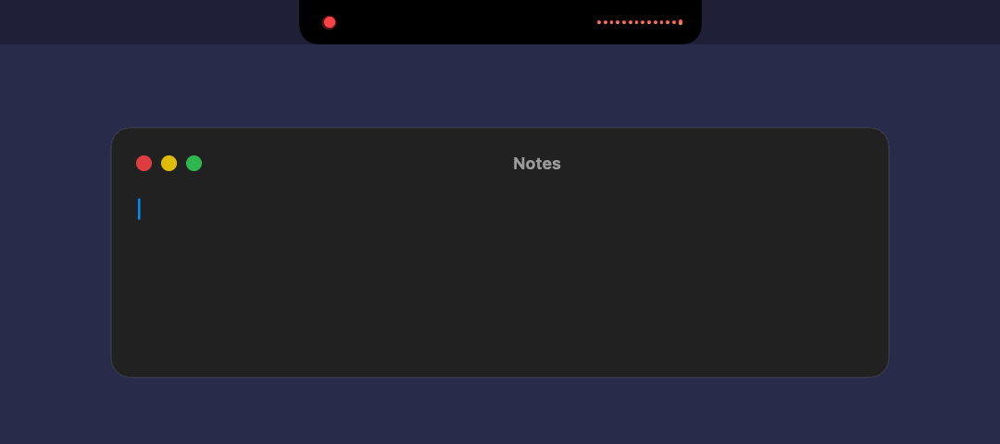

# BarkDictate

Hold Control + Option, talk, and your words show up in whatever app you're typing in. Everything runs on your Mac.



## Why I made this

I was exploring open source models on Hugging Face and came across [Bark 3.0 Pro](https://huggingface.co/ConwayResearch/Underdog-Bark-3.0-Pro), a speech model from Conway Research. By its makers' scoring it beats every other open model on the Open ASR Leaderboard's English tests, and the whole thing fits in about a gigabyte. I'd been using the Mac's built-in dictation for a while and kept getting annoyed at it, so I wanted to see what this model could do on a laptop.

It turned out to be fast. On my M4 MacBook Air it turns a few seconds of speech into text in about a tenth of a second. That made the obvious next step possible: type the words as I say them, and fix them as the model hears more. Then I wanted it to look good while it listens, so I gave it a little Dynamic Island in the notch.

## Setup

You need an Apple Silicon Mac on macOS 15 or newer.

1. Open Terminal and run:
   ```bash
   git clone https://github.com/meethjaswani/BarkDictate.git ~/BarkDictate
   cd ~/BarkDictate
   ./setup.sh
   ```
   This downloads the model (about 1.1 GB), builds the app and opens it.
2. Allow the microphone when asked.
3. Turn on BarkDictate in System Settings → Privacy & Security → Accessibility.
4. Click into any text box, hold Control + Option and talk.

## Using it

- **Hold ⌃⌥** to talk, let go to finish.
- **Tap ⌃⌥** for hands-free, tap again to stop.
- **Return** stops it and sends your last words first.
- It stops by itself after 30 seconds of silence.

If the island shows but nothing gets typed, switch BarkDictate off and on again in Accessibility. macOS forgets the approval after every rebuild.
